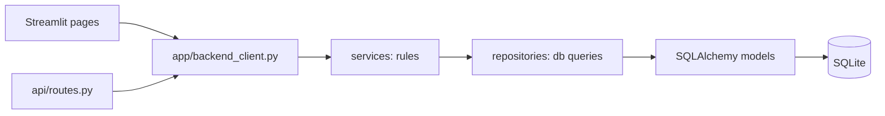

# EchoCampus

A college grievance portal I built so students can raise complaints and track them until they're closed.

## Why I built it

Complaints in college usually go through emails or paper forms, so nobody knows who is handling them or what happened next. Here every complaint goes to the right person automatically and its full history stays visible.

## Features

- Student registration with auto-generated IDs (`ST000101`, `ST000102` ...) and password strength rules
- Complaints routed to a grievance manager by category
- Priority detected from keywords (Critical / High / Medium / Low)
- Critical complaints get a Google Meet link
- Ticket IDs like `TKT-ABC12345`
- Status flow Pending → Assigned → In Progress → Resolved → Closed, with only the allowed moves
- Full timeline of every change on a complaint
- Manager dashboard: update status, add remarks, post updates to the admin, request closure
- Admin dashboard: stats, all complaints by category, manager updates, close requests

## Tech stack

- Python 3.12
- Streamlit (current UI)
- SQLAlchemy 2.x ORM on SQLite (`echocampus.db`)
- pydantic-settings (reads `.env`)
- bcrypt (password hashing)
- FastAPI + Uvicorn (optional API, not used by the UI yet)
- pandas (tables in the admin dashboard)
- pytest

## How it works

The code is split into layers so each part has one job:



- **models** describe the tables as Python classes
- **repositories** only read and write the database
- **services** hold the rules: routing, priority, the status machine, history
- `app/backend_client.py` turns service results into the dicts the Streamlit pages use

## Run it locally

You need Python 3.12 and git.

```bash
git clone https://github.com/saxenamayank-20/EchoCampus.git
cd EchoCampus
python3 -m venv .venv
source .venv/bin/activate
pip install -r requirements.txt
```

Create a `.env` file in the project folder with these variables (pick your own strong passwords):

```
ADMIN_SEED_PASSWORD=
GM001_PASSWORD=
GM002_PASSWORD=
GM003_PASSWORD=
GM004_PASSWORD=
```

They're used once to create the admin and the 4 manager accounts. An account with an empty password is skipped.

Create the tables and accounts, then start the app:

```bash
python scripts/seed.py
streamlit run main.py
```

The app runs on port 8501. To try the optional API (port 8000):

```bash
uvicorn api.routes:app --reload --port 8000
```

If you change a password in `.env` later, apply it with `python scripts/reset_seed_passwords.py`.

## API routes

The API has no login yet (that comes with JWT next), so it's only for local testing.

| Method | Route | What it does |
|---|---|---|
| POST | `/auth/login` | log in with user id + password |
| POST | `/auth/register` | register a student, returns the new id |
| POST | `/complaints/submit` | submit a complaint |
| GET | `/complaints/student/{student_id}` | a student's complaints |
| GET | `/complaints/manager/{manager_uid}` | a manager's complaints (`?resolved=true` for done ones) |
| POST | `/complaints/update-status` | manager changes status / remark |
| POST | `/complaints/request-close` | manager asks the admin to close |
| POST | `/complaints/admin-close` | admin closes a complaint |
| POST | `/complaints/manager-update` | manager posts an update for the admin |
| GET | `/complaints/manager-updates` | all manager updates |
| GET | `/complaints/{ticket_id}/timeline` | history of one complaint |
| GET | `/complaints/all` | every complaint |
| GET | `/users` | users (`?role=student` to filter) |
| GET | `/stats` | dashboard counts |
| GET | `/constants/categories` | complaint categories |
| GET | `/health` | health check |

## Project structure

```text
EchoCampus/
|-- main.py          streamlit entry point
|-- app/             streamlit pages, ui helpers, backend_client.py
|-- backend/
|   |-- app/
|   |   |-- core/          settings, enums, constants, password hashing
|   |   |-- db/            engine, session, seed
|   |   |-- models/        sqlalchemy tables
|   |   |-- repositories/  db queries
|   |   `-- services/      business rules + status machine
|   `-- tests/
|-- api/             optional fastapi routes
`-- scripts/         seed and password reset
```

## Running tests

```bash
pytest
```

Tests use a temporary SQLite file, so they never touch your real database.

## Challenges / what I learned

- The first version had real passwords in the code. I moved them to `.env`, and accounts with no password are skipped instead of being created with an empty one.
- All the SQL and rules lived in one file. Splitting it into models, repositories and services made each part small enough to test on its own.
- Any status could jump to any other. A small status machine now allows only the real moves and writes every change to the history.

## Known limitations and what's next

- The API has no authentication yet. Next is a FastAPI backend with JWT login, then a React frontend to replace Streamlit.
- SQLite is fine locally. PostgreSQL comes later, along with AI features (triage, duplicate detection, a policy assistant).
