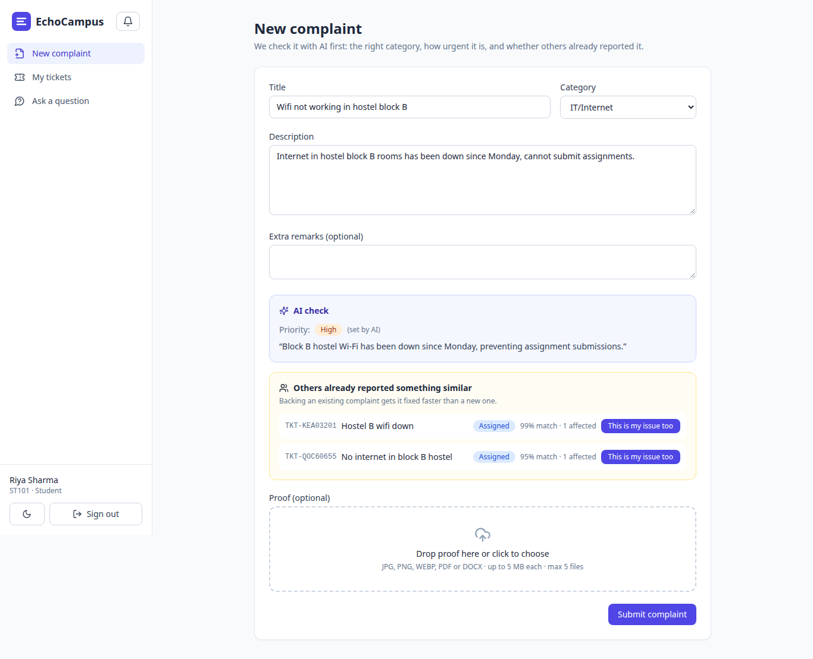
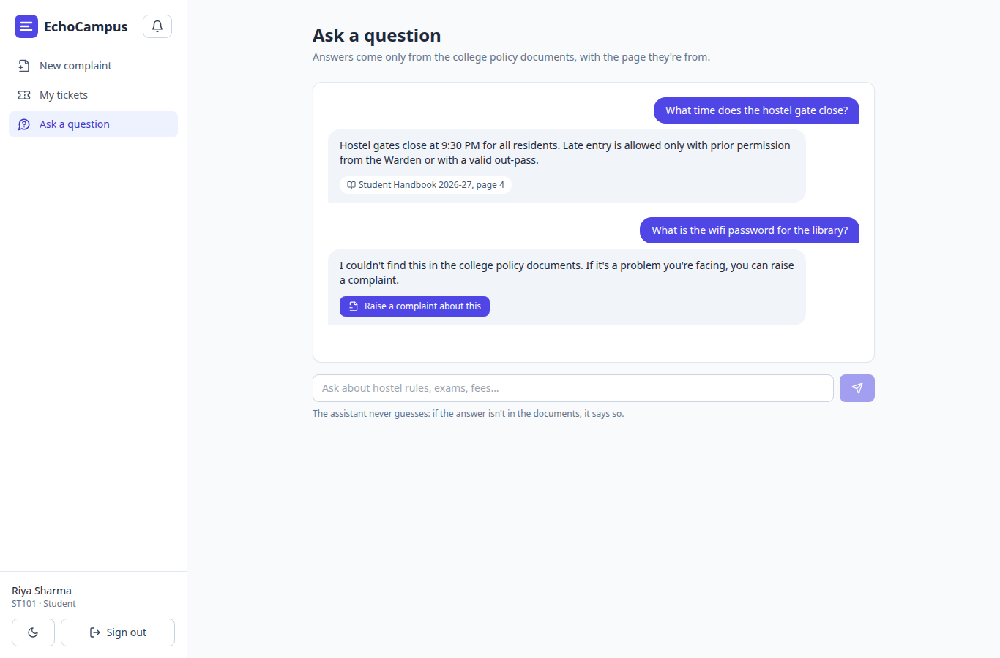
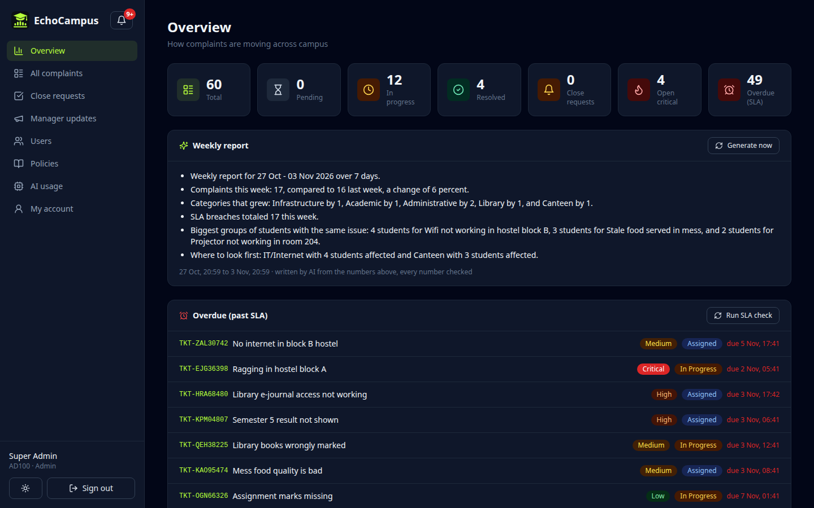
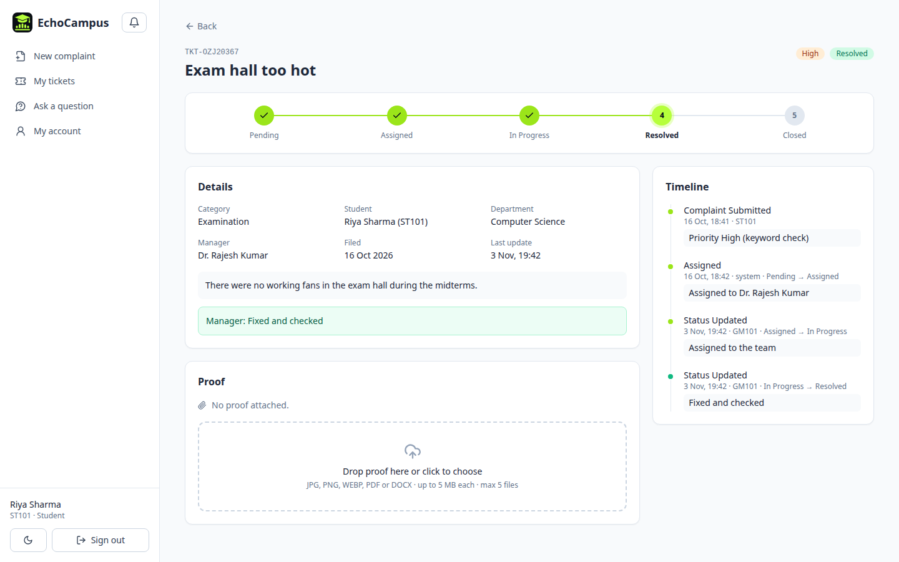
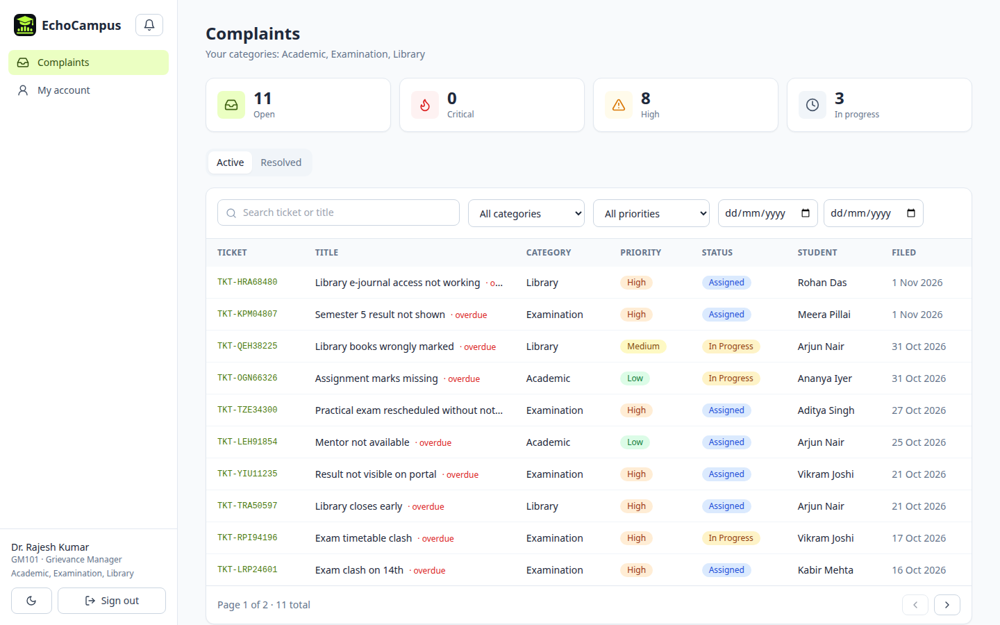
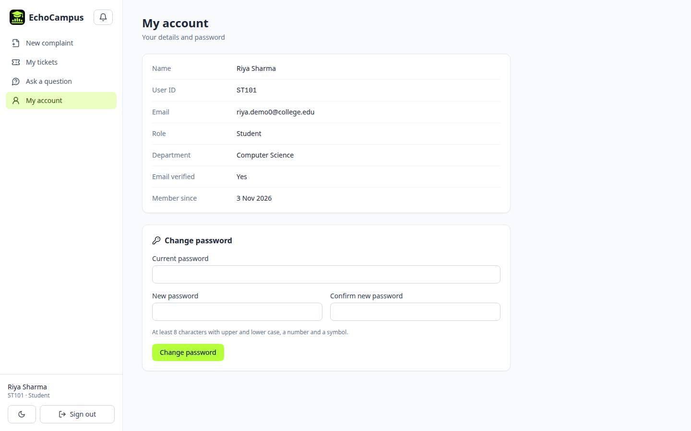
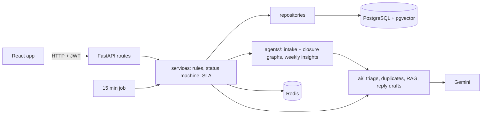

# EchoCampus

A college grievance portal I built so students can raise complaints, see who is handling them, and get them actually fixed, with AI that sorts complaints, spots duplicates, answers rule questions from the student handbook and writes a weekly report for the admin.



## Why I built it

In most colleges a complaint goes into an email or a paper form, and nobody knows who owns it or whether it was fixed. EchoCampus routes every complaint to the right manager, tracks it through a fixed status flow with deadlines, and only closes it after the student confirms the fix.

## Features

**Students**
- Register with email verification (6-digit code). The student ID (like `ST101`) is shown only after verifying, and is also emailed
- Raise a complaint with proof (photos, PDF, Word). Before submitting, an AI check suggests the right category and priority, and shows similar open complaints so you can back one ("I have this issue too") instead of filing a copy. Harassment, ragging and discrimination complaints stay private and are never shown to other students
- Crisis words (self-harm, suicide) always show helpline and counsellor contacts, even if the AI is down
- Track every complaint on a timeline, and confirm or dispute the fix when the manager marks it resolved
- Ask the policy assistant questions about rules, fees and timings. It answers only from the student handbook and shows the page

**Grievance managers**
- See only the complaints of their own categories: a summary page with boxes (Critical, High, escalated, per category…) where each box opens just those complaints, and Active / Resolved lists in the sidebar, with filters and paging
- Move complaints through Assigned → In Progress → Resolved (wrong moves are blocked), change the priority (never below Critical for harassment, ragging and discrimination), see which students backed a complaint, post updates to the admin
- Get an AI-drafted reply based on how similar complaints were fixed before (a draft only, nothing is sent automatically)

**Admin**
- Dashboard with charts, overdue (SLA) list, close requests, and a fix-quality table (dispute rate and student ratings per manager)
- Close complaints after the student confirmed, merge duplicates, upload the policy PDFs the assistant uses
- A weekly report (every Monday, or on demand) written by the AI from SQL numbers. Every number in it is checked, otherwise a plain summary is used
- An AI usage page: calls, failures, tokens and speed (average and p95) per AI feature

**Behind the scenes**
- A "My account" page for every role: your details, and a password change that asks for the current password first
- JWT login, role checks on every route, rate limits (5 complaints per hour, 10 login tries per 15 minutes for each user ID)
- SLA deadlines by priority, and a job every 15 minutes that escalates overdue complaints
- In-app notifications (bell) and email for status changes
- Light and dark mode, and the site can be installed as an app from the browser (it has its own icon)
- Submitting and closing run as LangGraph graphs. Closing pauses for the student and then the admin, and the paused state is saved in Postgres, so it survives a restart

## Screenshots

| | |
|---|---|
|  Policy assistant |  Admin dashboard (dark mode) |
|  Ticket timeline |  Manager's summary |
|  My account | |

## Tech stack

- **Backend:** Python 3.12, FastAPI, SQLAlchemy 2, Alembic, pydantic-settings, PyJWT, bcrypt, APScheduler
- **Database:** PostgreSQL on Neon with pgvector, also holds the uploaded files (a local SQLite file works for development)
- **Cache / rate limits:** Redis on Upstash (falls back to memory when not set)
- **AI:** Google Gemini through the `google-genai` SDK: `gemini-3.5-flash-lite` for text, `gemini-embedding-2` (768 dimensions) for embeddings
- **Agents:** LangGraph 1.2 (StateGraph, `interrupt` for human-in-the-loop) with `langgraph-checkpoint-postgres`
- **Frontend:** React 18, Vite 5, Tailwind CSS 3, React Router 6, TanStack Query 5, Recharts 3, lucide-react (plain JavaScript)
- **Packages:** uv (`pyproject.toml` + `uv.lock`)
- **Deployment:** Docker + docker compose, Render (backend), Vercel (frontend)
- **Tests:** pytest (fake AI in tests, plus optional real-Postgres tests), ruff for linting, GitHub Actions runs both on every push

## How it works



- The React app only talks to the API. The API checks the token and role, then calls a **service**, which holds the business rules.
- On submit, the complaint text goes through **AI triage** (category, priority, summary). The final priority is never lower than the keyword rules, so the AI can raise a priority but never lower it. If the AI fails, the keyword rules are used.
- Each complaint gets an **embedding** (768 numbers that capture its meaning). pgvector finds open complaints with a similar meaning, which is how duplicates show up.
- The **policy assistant** is RAG: the handbook in `data/policies/` is split into chunks, embedded and stored. A question is embedded, the closest chunks are found, and Gemini answers only from them with citations. If nothing matches, it says so.
- **Submitting** runs as a LangGraph graph: classify → check duplicates → route to the manager → escalate if Critical → notify. If an AI step fails, the graph takes the keyword path.
- **Closing** is a second graph that pauses twice with `interrupt()`, once waiting for the student and once for the admin. The paused state is saved in Postgres, and the student's answer or the admin's click resumes it. Both diagrams are in [docs/graphs.md](docs/graphs.md).
- More detail per step is in my learning notes (kept outside the repo). The full list of backend routes is in [docs/API.md](docs/API.md).

## Run it locally

**You need:** Python 3.12, [uv](https://docs.astral.sh/uv/), Node.js 18+, git. For the full setup: a free Neon database, a free Gemini API key (Google AI Studio), optionally a free Upstash Redis database and a Gmail app password for real emails.

```bash
git clone https://github.com/saxenamayank-20/EchoCampus.git
cd EchoCampus
uv sync                      # makes .venv and installs the exact versions from uv.lock
source .venv/bin/activate    # or put "uv run" in front of each command below
cd frontend && npm install && cd ..
```

Copy `.env.example` to `.env` in the project root and fill in your own values (`frontend/.env.example` has the one frontend variable). The variables:

```
DATABASE_URL            # Neon url; leave empty to use a local SQLite file
JWT_SECRET
ADMIN_SEED_PASSWORD  GM101_PASSWORD  GM102_PASSWORD  GM103_PASSWORD  GM104_PASSWORD
GEMINI_API_KEY          # empty = no AI, keyword rules only
REDIS_URL               # empty = in-memory cache
BREVO_API_KEY           # email over https (Brevo); needed on Render's free plan, which blocks SMTP
SMTP_HOST  SMTP_PORT  SMTP_USER  SMTP_PASSWORD  SMTP_FROM   # or plain SMTP; all empty = emails are printed in the backend log
EMAIL_LOGO_URL          # optional: logo image in the emails, defaults to the frontend icon
FRONTEND_ORIGIN         # the frontend address, for CORS
ALLOWED_EMAIL_DOMAINS   # e.g. your college domain; empty = any
COUNSELLOR_CONTACT  CRISIS_HELPLINE
```

Create the tables, add the staff accounts and the handbook, then start both parts:

```bash
alembic upgrade head
python scripts/seed.py                 # admin AD100 + managers GM101-GM104
python scripts/load_policies.py        # indexes data/policies/*.pdf for the assistant (needs GEMINI_API_KEY)
python scripts/seed_demo_data.py       # optional: 10 demo students + 60 complaints

uvicorn backend.app.main:app --reload --port 8000   # backend on port 8000
cd frontend && npm run dev                          # frontend on port 5173 (second terminal)
```

### Or with Docker

Needs only Docker. This starts Postgres (with pgvector), the backend and the frontend together, with its own empty database (not Neon). Keys like `GEMINI_API_KEY` and the staff passwords are read from `.env` if it exists.

```bash
docker compose up --build    # frontend on port 3000, backend on port 8000
docker compose down          # stop (add -v to also delete the database)
```

## Deployment

- **Backend:** Render (free web service). Build: `pip install uv && UV_PYTHON_DOWNLOADS=never uv sync --frozen --no-dev`. Start: `.venv/bin/alembic upgrade head && .venv/bin/uvicorn backend.app.main:app --host 0.0.0.0 --port $PORT`. Render checks a health route to know the app is up.
- **Frontend:** Vercel, root folder `frontend`, with `VITE_API_BASE_URL` set to the backend address. `frontend/vercel.json` sends every path to `index.html` so refreshing a page works.
- **Database:** Neon. **Cache:** Upstash Redis.
- The backend's `FRONTEND_ORIGIN` must be the exact Vercel address, otherwise the browser blocks the calls (CORS).

## Project structure

```text
EchoCampus/
|-- backend/
|   |-- app/          api routes, services, repositories, models, ai, agents, jobs
|   |-- alembic/      database migrations
|   `-- tests/
|-- frontend/         React + Vite app
|-- data/policies/    policy PDFs the assistant answers from
|-- scripts/          seed, demo data, load policies, export graphs, reset passwords
|-- docs/             API list, graph diagrams and screenshots
|-- .github/          CI workflow (ruff, tests, frontend build)
|-- Dockerfile        backend image (frontend/Dockerfile for the frontend)
|-- docker-compose.yml
`-- pyproject.toml    python packages (uv.lock has the exact versions)
```

## Running tests

```bash
uv run pytest
uv run ruff check backend scripts    # lint, same as CI
```

Tests use a temporary SQLite database and a fake AI, so they never touch real data or use the Gemini quota. Set `TEST_DATABASE_URL` to a Postgres url to also run the real-Postgres tests (they use a throwaway schema).

## Challenges / what I learned

- Keeping the AI safe: it may only raise a priority (the keyword rules are the floor), crisis help never depends on it, and the policy assistant has to cite a real source or say "not in the documents".
- A live test showed that `gemini-embedding-2` turns a plain list of texts into one vector. Sending each text as its own `Content` fixed it, and a check now fails loudly if the count is wrong.
- Moving from SQLite to Postgres with Alembic: real enum types, a sequence for student IDs (so two students can't get the same one), and making sure tests can never write into the real database.
- The first Render build crashed on a missing `numpy`: it was only installed on my laptop through another package. A fresh virtual environment now gets tested before deploying.
- Render's free disk is wiped on every restart, so files saved there disappeared. Storing them in a Postgres table fixed it, and the file is saved in the same commit as its attachment row.
- LangGraph's Postgres setup builds its indexes with `CREATE INDEX CONCURRENTLY`, which waits for every open transaction, so the first close request hung. The checkpoint tables are now created at startup, before any request runs.

## Known limitations and what's next

- Uploaded files (proof and policy PDFs) are kept in Postgres, not in object storage. Fine for this size (5 MB per file, 5 per complaint); a bigger setup would move them to something like S3.
- The Gemini free tier limits requests per minute, so the app throttles its own AI calls and falls back to the keyword rules when the AI is busy.
- With a local SQLite database, paused closing graphs are kept in memory only. After a restart the same step runs directly with the same rules, so nothing gets stuck.
- Render's free plan sleeps after 15 minutes without visitors, so the first load after that takes about a minute, and the 15-minute SLA job and the Monday report don't run while it sleeps.
- The Docker setup uses an in-memory cache instead of Redis, which is fine for one backend.
- Changing the password doesn't sign out other open sessions; their login token simply runs out within 30 minutes.
