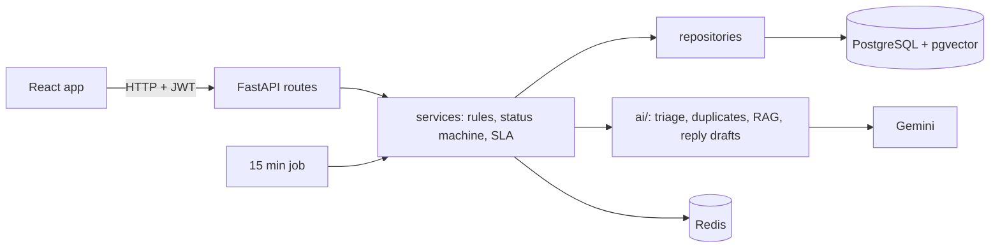

# EchoCampus

A college grievance portal I built so students can raise complaints, see who is handling them, and get them actually fixed, with AI that sorts complaints, spots duplicates and answers rule questions from the student handbook.


## Why I built it

In most colleges a complaint goes into an email or a paper form, and nobody knows who owns it or whether it was fixed. EchoCampus routes every complaint to the right manager, tracks it through a fixed status flow with deadlines, and only closes it after the student confirms the fix.

## Features

**Students**
- Register with email verification (6-digit code), log in with a short ID like `ST101`
- Raise a complaint with proof (photos, PDF, Word). Before submitting, an AI check suggests the right category and priority, and shows similar open complaints so you can back one ("I have this issue too") instead of filing a copy
- Crisis words (self-harm, suicide) always show helpline and counsellor contacts, even if the AI is down
- Track every complaint on a timeline, and confirm or dispute the fix when the manager marks it resolved
- Ask the policy assistant questions about rules, fees and timings. It answers only from the student handbook and shows the page

**Grievance managers**
- See only the complaints of their own categories, with filters and paging
- Move complaints through Assigned → In Progress → Resolved (wrong moves are blocked), change the priority, post updates to the admin
- Get an AI-drafted reply based on how similar complaints were fixed before (a draft only, nothing is sent automatically)

**Admin**
- Dashboard with charts, overdue (SLA) list, close requests, and a fix-quality table (dispute rate and student ratings per manager)
- Close complaints after the student confirmed, merge duplicates, upload the policy PDFs the assistant uses

**Behind the scenes**
- JWT login, role checks on every route, rate limits (5 complaints per hour, 10 login tries per 15 minutes)
- SLA deadlines by priority, and a job every 15 minutes that escalates overdue complaints
- In-app notifications (bell) and email for status changes

## Tech stack

- **Backend:** Python 3.12, FastAPI, SQLAlchemy 2, Alembic, pydantic-settings, PyJWT, bcrypt, APScheduler
- **Database:** PostgreSQL on Neon with pgvector (a local SQLite file works for development)
- **Cache / rate limits:** Redis on Upstash (falls back to memory when not set)
- **AI:** Google Gemini through the `google-genai` SDK: `gemini-3.5-flash-lite` for text, `gemini-embedding-2` (768 dimensions) for embeddings
- **Frontend:** React 18, Vite 5, Tailwind CSS 3, React Router 6, TanStack Query 5, Recharts 3, lucide-react (plain JavaScript)
- **Tests:** pytest (fake AI in tests, plus optional real-Postgres tests)

## How it works



- The React app only talks to the API. The API checks the token and role, then calls a **service**, which holds the business rules.
- On submit, the complaint text goes through **AI triage** (category, priority, summary). The final priority is never lower than the keyword rules, so the AI can raise a priority but never lower it. If the AI fails, the keyword rules are used.
- Each complaint gets an **embedding** (768 numbers that capture its meaning). pgvector finds open complaints with a similar meaning, which is how duplicates show up.
- The **policy assistant** is RAG: the handbook in `data/policies/` is split into chunks, embedded and stored. A question is embedded, the closest chunks are found, and Gemini answers only from them with citations. If nothing matches, it says so.
- More detail per step is in my learning notes (kept outside the repo) and in [docs/API.md](docs/API.md).

## Run it locally

**You need:** Python 3.12, Node.js 18+, git. For the full setup: a free Neon database, a free Gemini API key (Google AI Studio), optionally a free Upstash Redis database and a Gmail app password for real emails.

```bash
git clone https://github.com/saxenamayank-20/EchoCampus.git
cd EchoCampus
python3 -m venv .venv
source .venv/bin/activate
pip install -r requirements.txt
cd frontend && npm install && cd ..
```

Create a `.env` file in the project root. Variable names (fill in your own values):

```
DATABASE_URL            # Neon url; leave empty to use a local SQLite file
JWT_SECRET
ADMIN_SEED_PASSWORD  GM101_PASSWORD  GM102_PASSWORD  GM103_PASSWORD  GM104_PASSWORD
GEMINI_API_KEY          # empty = no AI, keyword rules only
REDIS_URL               # empty = in-memory cache
SMTP_HOST  SMTP_PORT  SMTP_USER  SMTP_PASSWORD  SMTP_FROM   # empty = emails are printed in the backend log
FRONTEND_ORIGIN         # the frontend address, for CORS
ALLOWED_EMAIL_DOMAINS   # e.g. your college domain; empty = any
COUNSELLOR_CONTACT  CRISIS_HELPLINE
```

Create the tables, add the staff accounts and the handbook, then start both parts:

```bash
alembic upgrade head
python scripts/seed.py                 # admin AD100 + managers GM101-GM104
python scripts/load_policies.py        # indexes data/policies/*.pdf for the assistant (needs GEMINI_API_KEY)
python scripts/seed_demo_data.py       # optional: 10 demo students + 60 complaints

uvicorn backend.app.main:app --reload --port 8000   # backend on port 8000, Swagger at /docs
cd frontend && npm run dev                          # frontend on port 5173 (second terminal)
```

## API routes

The main ones (all 42 are in [docs/API.md](docs/API.md)):

| Method | Route | What it does |
|---|---|---|
| POST | `/auth/register` | register a student, emails a 6-digit code |
| POST | `/auth/login` | log in, returns a JWT |
| POST | `/complaints/preview` | AI check before submit: category, priority, crisis help, similar complaints |
| POST | `/complaints` | submit a complaint |
| GET | `/complaints` | list complaints (filtered by role), with filters and paging |
| POST | `/complaints/{ticket_id}/confirm` | student confirms or disputes the fix |
| POST | `/manager/complaints/{ticket_id}/status` | manager changes the status (status machine checked) |
| POST | `/manager/complaints/{ticket_id}/reply-suggestion` | AI reply draft for the manager |
| POST | `/admin/complaints/{ticket_id}/close` | admin closes after the student confirmed |
| POST | `/assistant/ask` | policy question, answered from the handbook with page citations |
| GET | `/admin/stats` | dashboard numbers and charts |

## Project structure

```text
EchoCampus/
|-- backend/
|   |-- app/          api routes, services, repositories, models, ai, jobs
|   |-- alembic/      database migrations
|   `-- tests/
|-- frontend/         React + Vite app
|-- data/policies/    policy PDFs the assistant answers from
|-- scripts/          seed, demo data, load policies, reset passwords
`-- docs/             API list and screenshots
```

## Running tests

```bash
pytest
```

Tests use a temporary SQLite database and a fake AI, so they never touch real data or use the Gemini quota. Set `TEST_DATABASE_URL` to a Postgres url to also run the real-Postgres tests (they use a throwaway schema).

## Challenges / what I learned

- Keeping the AI safe: it may only raise a priority (the keyword rules are the floor), crisis help never depends on it, and the policy assistant has to cite a real source or say "not in the documents".
- A live test showed that `gemini-embedding-2` turns a plain list of texts into one vector. Sending each text as its own `Content` fixed it, and a check now fails loudly if the count is wrong.
- Moving from SQLite to Postgres with Alembic: real enum types, a sequence for student IDs (so two students can't get the same one), and making sure tests can never write into the real database.

## Known limitations and what's next

- Not deployed yet. Uploaded files are stored on the local disk; cloud storage comes with deployment.
- The Gemini free tier limits requests per minute, so the app throttles its own AI calls and falls back to the keyword rules when the AI is busy.
- Next: LangGraph agents for the submission and closing flows, and a weekly AI insights report for the admin.


