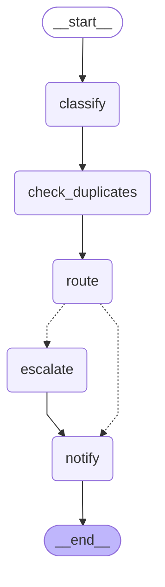
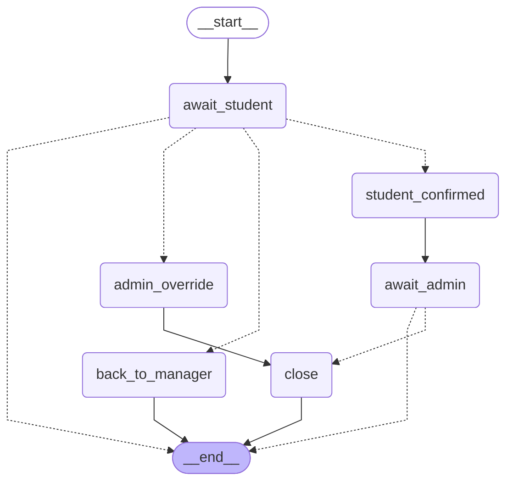

# EchoCampus graphs

Generated by `python scripts/export_graphs.py` from the LangGraph code.

## Intake (submitting a complaint)

Dotted arrows are conditional (Critical or not).

## Closure (human in the loop)

`await_student` and `await_admin` pause the graph until a person answers. The paused state is saved in Postgres.

